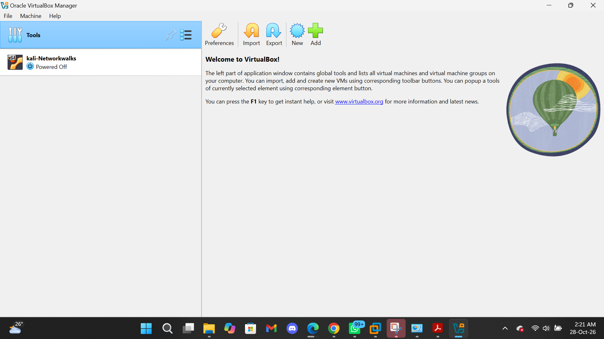
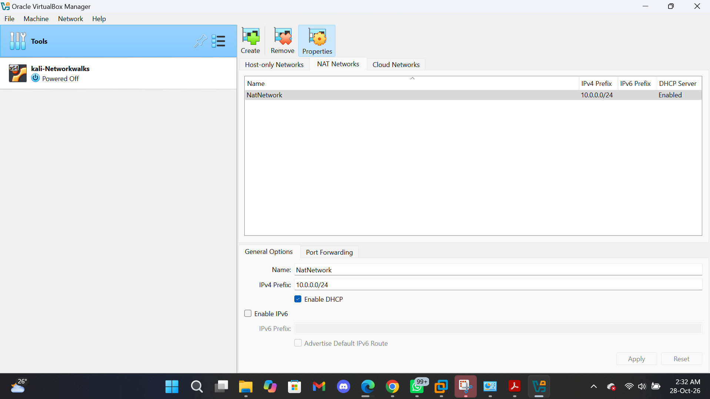
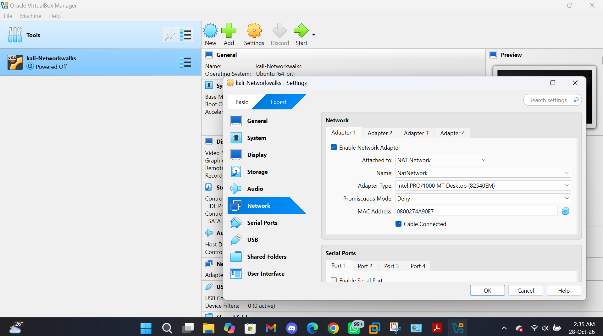
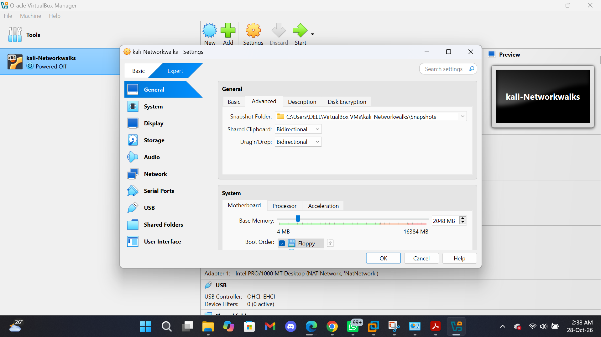
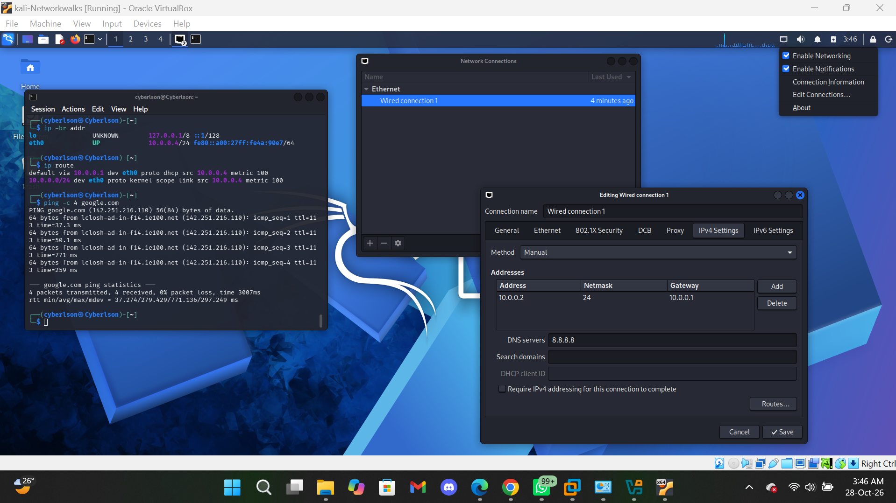
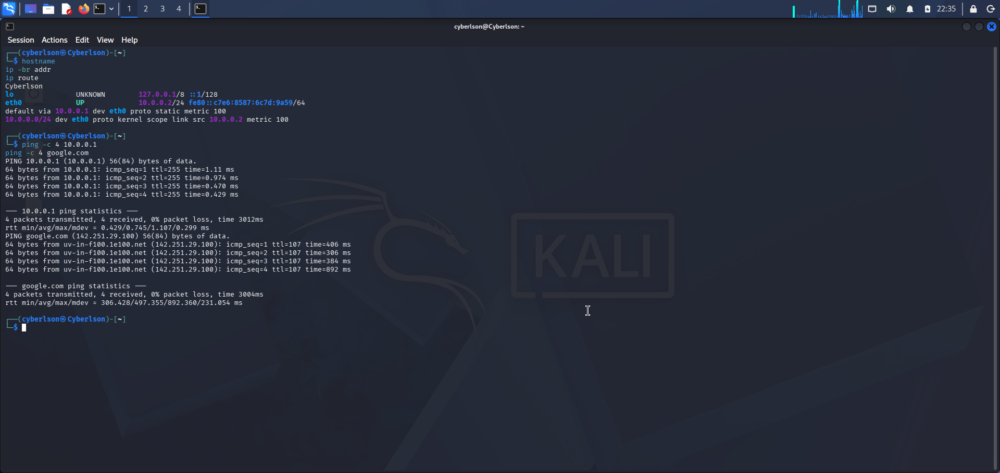
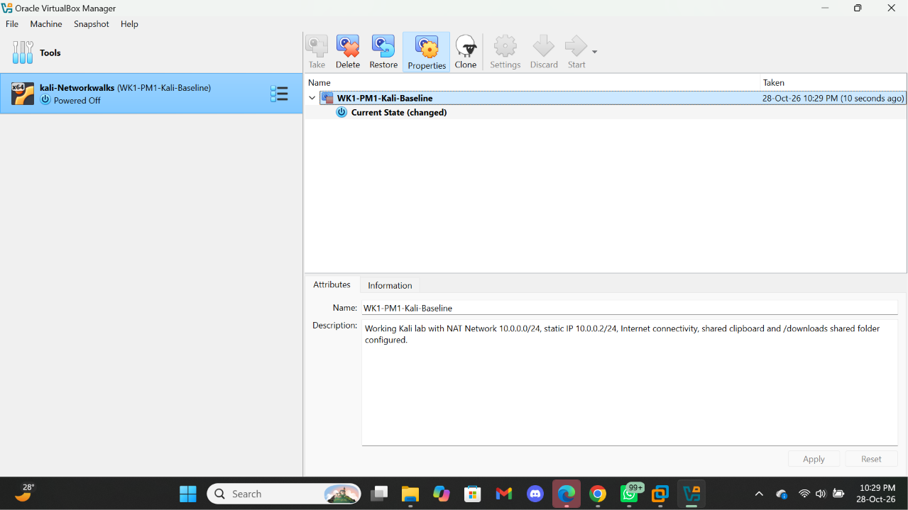
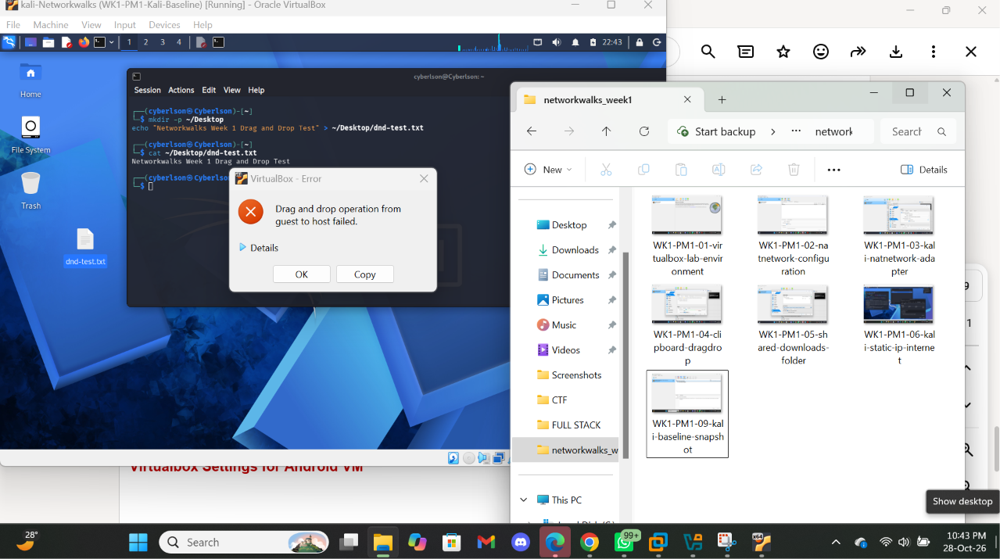
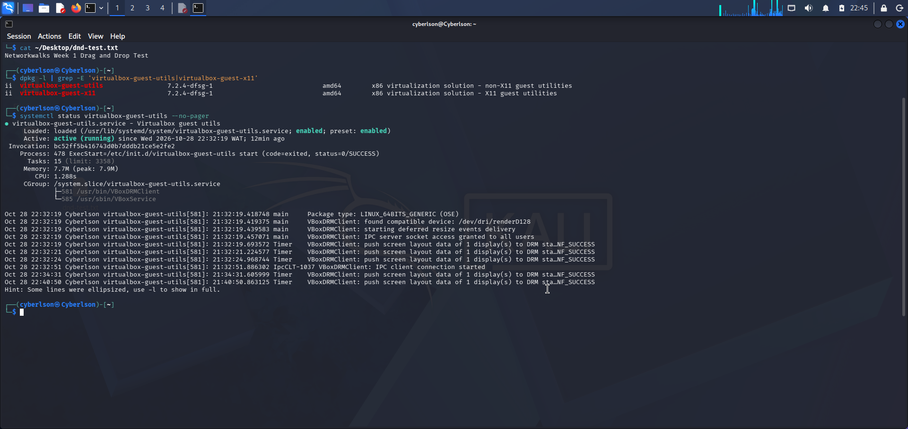
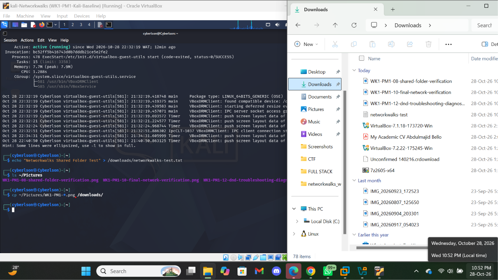

# Cybersecurity Lab Setup - WK1-PM1

**Networkwalks Cybersecurity Internship**

**Intern:** Abdulmajid Bello  
**Batch:** B0840  
**Intern No.:** NW-084-2ST  
**Project:** WK1-PM1 — Cybersecurity Lab Setup

---

## Project Overview

This repository documents my Week 1 cybersecurity lab setup for the Networkwalks Cybersecurity Internship.

The goal was to build a working virtual lab that I can continue using for networking, vulnerability assessment, penetration testing and other security exercises during the internship.

Rather than treating this as just an installation task, I wanted the setup to be easy to reproduce and troubleshoot. The final environment uses Kali Linux inside VirtualBox, connected through a dedicated NAT Network with a static IP address and Internet access.

I also configured host/guest integration, a shared folder for moving files between Windows and Kali, and a clean VM snapshot that I can return to if something breaks during future labs.

---

## Lab Architecture

My current environment is:

| Component | Configuration |
|---|---|
| Host OS | Windows 11 |
| Hypervisor | Oracle VirtualBox 7.1.x |
| Security VM | Kali Linux |
| Virtual Network | NAT Network |
| Lab Subnet | `10.0.0.0/24` |
| Kali IP | `10.0.0.2/24` |
| Gateway | `10.0.0.1` |
| DNS | `8.8.8.8` |
| Shared Folder | Windows Downloads → `/downloads` |
| Shared Clipboard | Bidirectional |
| Drag and Drop | Bidirectional configured |
| Internet Access | Working |
| VM Snapshot | Created |

The basic network layout is:

```text
                         Internet
                            |
                            |
                     Windows 11 Host
                            |
                    Oracle VirtualBox
                            |
                NAT Network: 10.0.0.0/24
                            |
                    Gateway: 10.0.0.1
                            |
                      Kali Linux
                       10.0.0.2
```

This gives me a predictable network environment that can later be expanded with additional lab machines.

---

## 1. VirtualBox and Kali Environment

I started by preparing VirtualBox and the Kali Linux VM that would serve as the main security testing machine.

The VM was kept separate from the host environment so that future security exercises can be performed inside a controlled virtual lab.



---

## 2. Creating the NAT Network

Instead of leaving Kali on VirtualBox's default NAT mode, I created a dedicated **NAT Network**.

The network was configured with:

```text
Network: 10.0.0.0/24
DHCP: Enabled
IPv6: Disabled
```



Using a NAT Network gives the lab its own subnet while still allowing the virtual machines to reach the Internet through the host.

It also gives me room to add more machines later without redesigning the lab network.

---

## 3. Connecting Kali to the Lab Network

Kali's first virtual network adapter was changed from normal NAT to the newly created NAT Network.

The adapter configuration was:

```text
Attached to: NAT Network
Network: NatNetwork
Cable Connected: Yes
```



At this point, Kali became part of the `10.0.0.0/24` lab network.

---

## 4. Host and Guest Integration

For easier interaction between Windows and Kali, I enabled:

- Shared Clipboard — Bidirectional
- Drag and Drop — Bidirectional



Shared Clipboard worked successfully during testing.

Drag and Drop required some additional troubleshooting, which I have documented later in this README rather than simply marking it as working.

---

## 5. Shared Folder

I also configured my Windows Downloads directory as a VirtualBox shared folder.

The host directory was mapped to:

```text
/downloads
```

inside Kali.


I verified the mount from Kali and confirmed that files in the shared directory could be accessed.


This turned out to be particularly useful because it provided a reliable way of moving files between Kali and Windows.

---

## 6. Kali Static IP Configuration

Kali was configured with a manual IPv4 address rather than relying on a changing DHCP address.

The final configuration was:

```text
IP Address: 10.0.0.2
Prefix:     /24
Gateway:    10.0.0.1
DNS:        8.8.8.8
```

After applying the configuration, I tested external connectivity successfully.



Having a predictable IP address is useful for a security lab because future machines and tools can consistently reference the Kali system at `10.0.0.2`.

---

## 7. Network Verification

I didn't want to rely only on the graphical network settings, so I verified the configuration from the Kali terminal.

Some of the commands used were:

```bash
ip -br addr
ip route

ping -c 4 10.0.0.1
ping -c 4 8.8.8.8
ping -c 4 google.com
```

These checks allowed me to verify:

- Kali had the expected `10.0.0.2/24` address.
- A default route was present.
- The VirtualBox gateway was reachable.
- External IP connectivity was working.
- DNS resolution was working.

I repeated the checks after restarting the VM to make sure the configuration persisted.



---

## 8. Creating a Clean Baseline Snapshot

Once the main environment was working, I created a VirtualBox snapshot named:

```text
WK1-PM1-Kali-Baseline
```



This is an important part of how I plan to use the lab going forward.

If a future security exercise, configuration change or tool installation causes problems, I can return to this known working state instead of rebuilding Kali from scratch.

---

# Troubleshooting

## Kali → Windows Drag and Drop — `VERR_TIMEOUT`

One issue I ran into during the setup involved VirtualBox Drag and Drop.

Bidirectional Drag and Drop was enabled in the VM settings.

Testing showed:

```text
Windows → Kali: Working
Kali → Windows: Failed
Shared Clipboard: Working
Shared Folder: Working
```

When attempting to drag a file from Kali back to the Windows host, VirtualBox returned:

```text
VBOX_E_DND_ERROR (0x80bb0011)
VERR_TIMEOUT
```



### What I checked

I first checked whether the VirtualBox guest components were actually installed:

```bash
dpkg -l | grep -E 'virtualbox-guest-utils|virtualbox-guest-x11'
```

Both packages were present.

I then checked the guest service:

```bash
systemctl status virtualbox-guest-utils --no-pager
```

The service returned:

```text
Active: active (running)
```



This was useful because it ruled out the obvious case of Guest Utilities simply being missing or stopped.

### Practical Workaround

Rather than repeatedly changing a working VM just to solve one integration feature, I tested the `/downloads` shared folder as an alternative.

I created a test file from Kali inside the shared directory and confirmed that it appeared correctly in Windows.



So although Kali → Windows Drag and Drop continued to return `VERR_TIMEOUT`, file transfer between both systems was still available through the shared folder.

I kept the working lab configuration rather than risking the rest of the environment for a feature that already had a reliable workaround.

---

## Final Lab Status

| Test | Result |
|---|---|
| Kali boots successfully | ✅ |
| NAT Network `10.0.0.0/24` | ✅ |
| Kali static IP `10.0.0.2/24` | ✅ |
| Gateway connectivity | ✅ |
| Internet connectivity | ✅ |
| DNS resolution | ✅ |
| Shared Clipboard | ✅ |
| Windows → Kali Drag and Drop | ✅ |
| Kali → Windows Drag and Drop | ⚠️ `VERR_TIMEOUT` |
| `/downloads` shared folder | ✅ |
| Kali → Windows via shared folder | ✅ |
| Baseline snapshot | ✅ |

---

## What I Took Away From This Lab

Most of the individual configuration steps were familiar, but putting them together as a reusable security lab was the useful part of this project.

A few things stood out to me.

First, **NAT and NAT Network are not the same thing**. A dedicated NAT Network gives me a defined subnet that can later contain several lab machines while still providing outbound Internet access.

Second, having predictable addressing matters. Keeping Kali at `10.0.0.2/24` will make later multi-machine exercises easier to manage and document.

The Drag and Drop issue was also a useful reminder not to assume that an enabled feature is automatically a working feature. Checking the guest packages and service helped narrow down the problem, while the shared folder gave me a practical alternative without disturbing the rest of the environment.

Finally, taking a snapshot after reaching a known-good state is something I want to keep doing as the lab grows. Once more vulnerable machines and security tools are introduced, being able to roll back quickly will save a lot of time.

---

## Future Expansion

The current setup gives me the foundation for adding more machines to the same lab network.

As the internship progresses, this environment can be expanded with additional Windows/Linux targets and used for areas such as:

- Network reconnaissance
- Traffic analysis
- Vulnerability assessment
- Web application security testing
- Penetration-testing practice
- Security monitoring and incident analysis

Any testing performed from this environment will remain limited to systems I own, intentionally vulnerable labs, or systems where explicit authorization has been provided.

---

## Project Context

This lab was completed as part of **Week 1 (WK1-PM1)** of my **Networkwalks Cybersecurity Internship**.

The original project requirements and learning workflow were provided by Networkwalks. This repository is my own implementation, verification, troubleshooting notes and documentation of the lab I built.

---

## Author

**Abdulmajid Bello**  
Cybersecurity Intern — Networkwalks  
**Batch:** B0840  
**Intern No.:** NW-084-2ST

*Building practical skills in network security, penetration testing and vulnerability assessment through hands-on labs.*